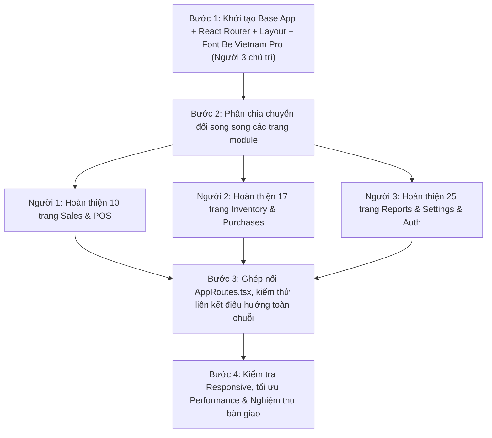

# KẾ HOẠCH & PHÂN CÔNG CHUYỂN ĐỔI SANG REACT ROUTER & COMPONENT TYPESCRIPT
## HỆ THỐNG QUẢN LÝ CHUỖI TRÀ SỮA MILTYWAY (12 CHI NHÁNH)

---

> **LƯU Ý QUAN TRỌNG:**
> - **Font chữ toàn hệ thống sau chuyển đổi:** `Be Vietnam Pro` (thay thế và đồng bộ 100% trên toàn bộ giao diện).
> - **Nguyên tắc kỹ thuật:** Chuyển đổi toàn bộ mã nguồn giao diện HTML tĩnh sang **Single Page Application (SPA)** với **React + TypeScript (.tsx)** và **React Router**.
> - **Quy định ràng buộc:** Tận dụng tối đa Tailwind CSS và các class/biến CSS đã xây dựng trong `assets/css/app.css`. Tuyệt đối **KHÔNG** tự ý cài đặt thêm các framework CSS bên thứ ba (như Bootstrap, Ant Design, MUI, Chakra) làm phá vỡ chuẩn giao diện ban đầu.

---

## I. QUY CHUẨN CHUNG BẮT BUỘC CHO CẢ 3 THÀNH VIÊN

### 1. Nguyên Tắc Làm Việc Khi Lên React + TypeScript
1. **Thống nhất cấu trúc và cơ chế chuyển đổi trước khi code riêng:** Cả 3 người cùng xây dựng trên một base chung (Vite + React Router + TypeScript). Không ai tự ý cấu hình lại router riêng hoặc dùng cơ chế nạp CSS khác biệt.
2. **Bảo tồn trọn vẹn HTML/CSS đã hoàn thiện:** Quá trình chuyển sang `.tsx` bản chất là đóng gói mã nguồn HTML chuẩn thành JSX/TSX hợp lệ (thay `class` thành `className`, `for` thành `htmlFor`, đóng tất cả thẻ tự đóng ``, `<input />`, `<br />`, `<hr />`, inline `style` đổi sang object).
3. **Phân tách trách nhiệm (Clean Separation):**
   - Giai đoạn này tập trung vào: **Component hóa UI, điều hướng React Router, Mock Data/State hiển thị**.
   - Các logic gọi API thực tế, cơ sở dữ liệu backend sẽ chuẩn bị sẵn interface và hook, chưa can thiệp làm vỡ giao diện.
4. **Không tự ý thay đổi layout dùng chung:** Mọi thay đổi với `MainLayout`, `Sidebar`, `Header` hoặc CSS root phải do Người 3 điều phối và thống nhất với Người 1 & Người 2.

---

### 2. Các Thành Phần Bắt Buộc Phải Thống Nhất

#### 2.1. Khung Giao Diện Dùng Chung (Layout Architecture)
Toàn bộ ứng dụng chạy qua 2 Layout chính:
- **`MainLayout.tsx` (Dành cho Dashboard & Tất cả nghiệp vụ quản trị):**
  - Chứa `<Sidebar />` bên trái (responsive drawer trên mobile).
  - Chứa `<Header />` bên trên (thanh tìm kiếm toàn cục, nút toggle dark mode, chuông thông báo, menu tài khoản).
  - Khung nội dung chính `<main>` bọc bằng `<Outlet />` của React Router.
  - Phía dưới là `<Footer />` và container `<ToastContainer />`.
- **`AuthLayout.tsx` (Dành cho các trang xác thực):**
  - Nền hiệu ứng chuyên dụng (`auth-body`, `auth-bg-shape`).
  - Không nạp Sidebar và Header để tối ưu trải nghiệm tập trung.
  - Chứa thẻ `<Outlet />` căn giữa màn hình.

#### 2.2. Hệ Thống Màu Sắc, Typography & Font Chữ
- **Font chữ chuẩn:** `Be Vietnam Pro` (khai báo `font-family: 'Be Vietnam Pro', sans-serif;` tại root).
- **Màu sắc nhận diện (Design Tokens):**
  - **Màu thương hiệu chính (Primary):** `#22B573` (Emerald Green F&B) — biến CSS `--primary`.
  - **Nền trang & Nền thẻ:** `--background` (`#F8FAFC` light / `#0F172A` dark) và `--surface` (`#FFFFFF` light / `#1E293B` dark).
  - **Màu văn bản:** `--text` (chính), `--muted` (phụ), `--heading-color` (tiêu đề).
  - **Màu trạng thái nghiệp vụ:**
    - Thành công (Success / Đã thanh toán / Hoàn thành): `#22B573`
    - Cảnh báo (Warning / Chờ duyệt / Sắp hết hạn): `#F59E0B`
    - Lỗi / Nguy hiểm (Danger / Đã hủy / Lỗ / Quá date): `#EF4444`
    - Thông tin (Info / Đang pha chế / Hội viên): `#3B82F6`

#### 2.3. Bộ Component Dùng Chung Cần Tái Sử Dụng
Tất cả 3 thành viên khi chuyển đổi màn hình của mình **bắt buộc import từ thư mục `src/components/common/`**, không tự code lại:
- **`StatCard.tsx`:** Hiển thị thẻ KPI đúng chuẩn (`stat-card`, `stat-card-icon`, `stat-card-body`, `stat-label`, `stat-value`, `stat-sub-label`).
- **`Badge.tsx`:** Nhãn trạng thái chuẩn màu F&B (`badge badge-success`, `badge-warning`, `badge-danger`, `badge-info`, `badge-purple`).
- **`DataTable.tsx`:** Khung bảng dữ liệu có hover, phân trang và cuộn ngang `overflow-x-auto`.
- **`Modal.tsx` & `ConfirmDialog.tsx`:** Hộp thoại pop-up chuẩn xác nhận hủy/xóa/đóng ca.
- **`Toast.tsx` / `useToast()`:** Hệ thống thông báo tự nổi góc phải màn hình.

#### 2.4. Quy Chuẩn Dữ Liệu Hiển Thị (Display Formatting)
- **Ngôn ngữ:** 100% Tiếng Việt có dấu, văn phong quản trị SaaS chuyên nghiệp.
- **Tiền tệ:** Định dạng chuẩn Việt Nam: `1.842.600.000 ₫` hoặc `89.000 đ` (viết helper function `formatCurrency(amount: number): string`).
- **Ngày giờ:** Thống nhất định dạng `dd/MM/yyyy` (ví dụ: `30/10/2026`) hoặc `HH:mm dd/MM/yyyy` cho hóa đơn/phiếu ca.

---

### 3. Quy Định Dùng Tailwind CSS & CSS Toàn Cục
1. **Cấu hình Tailwind:** File `src/input.css` nạp font `Be Vietnam Pro` từ Google Fonts hoặc local font. Khai báo alias:
   ```js
   fontFamily: {
     sans: ['"Be Vietnam Pro"', 'sans-serif'],
   }
   ```
2. **Không phá vỡ class responsive:** Toàn bộ responsive chuẩn `sm:`, `md:`, `lg:`, `xl:` đã test kỹ ở bản HTML phải được giữ nguyên vẹn trong prop `className` của React component.
3. **Quản lý CSS Root:** File `assets/css/app.css` giữ nguyên các biến `:root`, style in ấn `@media print` cho bill K80/K57 và các class tiện ích đặc thù (`.stat-card`, `.stat-value`, `.filter-bar`).

---

## II. PHÂN CÔNG CHI TIẾT THEO PHẠM VI 3 NGƯỜI

```
src/
├── layouts/
│   ├── MainLayout.tsx                  # Người 3 phụ trách chính
│   └── AuthLayout.tsx                  # Người 3 phụ trách chính
├── components/
│   ├── shared/
│   │   ├── Sidebar.tsx                 # Người 3 phụ trách chính
│   │   ├── Header.tsx                  # Người 3 phụ trách chính
│   │   ├── GlobalSearch.tsx            # Người 3 phụ trách chính
│   │   └── Footer.tsx                  # Người 3 phụ trách chính
│   └── common/
│       ├── StatCard.tsx                # Dùng chung (Người 3 cung cấp)
│       ├── Badge.tsx                   # Dùng chung
│       ├── Modal.tsx                   # Dùng chung
│       └── ToastContainer.tsx          # Dùng chung
├── pages/
│   ├── sales/                          # MODULE NGƯỜI 1
│   ├── inventory/                      # MODULE NGƯỜI 2
│   ├── purchases/                      # MODULE NGƯỜI 2
│   ├── production/                     # MODULE NGƯỜI 2
│   ├── stores/                         # MODULE NGƯỜI 2
│   ├── invoices/                       # MODULE NGƯỜI 3
│   ├── reports/                        # MODULE NGƯỜI 3
│   ├── settings/                       # MODULE NGƯỜI 3
│   ├── users/                          # MODULE NGƯỜI 3
│   └── auth/                           # MODULE NGƯỜI 3
└── routes/
    └── AppRoutes.tsx                   # Khung Router chính
```

---

### 👤 NGƯỜI 1 — BÁN HÀNG & KHÁCH HÀNG (Sales · POS · Customer-facing)

#### 1. Danh sách file HTML phụ trách chuyển sang Component TypeScript:

| STT | File HTML Gốc | File Component React / TSX Đích | Đường Dẫn React Route | Chức Năng Chính |
| :---: | :--- | :--- | :--- | :--- |
| 1 | `dashboard.html` | `src/pages/sales/DashboardPage.tsx` | `/dashboard` | Thẻ KPI chuỗi, biểu đồ bán hàng, bộ lọc chi nhánh |
| 2 | `sales/add-sale.html` | `src/pages/sales/PosTerminalPage.tsx` | `/sales/pos` | Giao diện thu ngân POS touch: size, đường, đá, topping |
| 3 | `sales/sales.html` | `src/pages/sales/SalesListPage.tsx` | `/sales` | Bảng quản lý đơn hàng toàn chuỗi, tra cứu trạng thái |
| 4 | `sales/sales-returns.html`| `src/pages/sales/SalesReturnsPage.tsx` | `/sales/returns` | Quản lý biên bản trả hàng, hoàn tiền khách |
| 5 | `sales/shifts.html` | `src/pages/sales/ShiftsPage.tsx` | `/sales/shifts` | Quản lý ca làm việc, mở/đóng ca quầy thu ngân |
| 6 | `sales/preparation.html` | `src/pages/sales/PreparationQueuePage.tsx`| `/sales/preparation`| Màn hình hiển thị hàng đợi Barista pha chế (KDS) |
| 7 | `customers/customers.html`| `src/pages/sales/CustomersPage.tsx` | `/customers` | Bảng hội viên, hạng thẻ Member/Gold/VIP, điểm tích |
| 8 | `marketing/promotions.html`| `src/pages/sales/PromotionsPage.tsx`| `/marketing/promotions`| Danh sách voucher, mã giảm giá, khuyến mãi chuỗi |
| 9 | `online/menu.html` *(nếu có)*| `src/pages/sales/OnlineMenuPage.tsx` | `/online/menu` | Giao diện xem thực đơn đồ uống trực tuyến |
| 10 | `online/orders.html` *(nếu có)*| `src/pages/sales/OnlineOrdersPage.tsx`| `/online/orders` | Danh sách đơn hàng đặt qua kênh trực tuyến |

#### 2. Công việc TypeScript & React Router cụ thể:
- **POS Terminal Component (`PosTerminalPage.tsx`):**
  - Chuyển đổi giao diện chọn option món nước thành State Component (chọn size M/L, % đường, % đá, danh sách checkbox topping).
  - Tách giỏ hàng bên phải thành component con `CartDrawer.tsx` hoặc `PosCart.tsx`.
- **Hàng đợi Barista (`PreparationQueuePage.tsx`):**
  - Giữ nguyên các badge màu sắc thể hiện tiến độ: `Chờ pha chế`, `Đang thực hiện`, `Đã xong`.
- **Liên kết điều hướng:**
  - Thay toàn bộ thẻ `<a href="add-sale.html">` thành `<Link to="/sales/pos">` hoặc `<NavLink>`.
  - Sử dụng hook `useNavigate()` cho các nút thao tác nhanh (như bấm *"Tạo đơn mới"* chuyển thẳng sang POS).

---

### 👤 NGƯỜI 2 — KHO, NGUYÊN LIỆU & CUNG ỨNG (Inventory · Production · Procurement)

#### 1. Danh sách file HTML phụ trách chuyển sang Component TypeScript:

| STT | File HTML Gốc | File Component React / TSX Đích | Đường Dẫn React Route | Chức Năng Chính |
| :---: | :--- | :--- | :--- | :--- |
| 1 | `inventory/products.html` | `src/pages/inventory/ProductsPage.tsx` | `/inventory/products` | Danh mục món nước, bảng giá, trạng thái kinh doanh |
| 2 | `inventory/ingredients.html`| `src/pages/inventory/IngredientsPage.tsx`| `/inventory/ingredients`| Quản lý nguyên vật liệu: trà lá, sữa, trân châu, siro |
| 3 | `inventory/add-product.html`| `src/pages/inventory/AddProductPage.tsx` | `/inventory/products/new`| Form thêm món đồ uống mới kèm công thức |
| 4 | `inventory/product-details.html`| `src/pages/inventory/ProductDetailsPage.tsx`| `/inventory/products/:id`| Xem chi tiết món, giá bán và cấu phần nguyên liệu |
| 5 | `inventory/categories.html`| `src/pages/inventory/CategoriesPage.tsx` | `/inventory/categories` | Quản lý nhóm đồ uống (Trà sữa, Trà trái cây, Macchiato) |
| 6 | `inventory/branches.html` | `src/pages/inventory/BranchesPage.tsx` | `/inventory/branches` | Danh sách 12 chi nhánh cửa hàng và kho trung tâm |
| 7 | `inventory/units.html` | `src/pages/inventory/UnitsPage.tsx` | `/inventory/units` | Đơn vị tính F&B: Ly, Kg, Gram, Hộp, Gói, Thùng |
| 8 | `inventory/stock-adjustment.html`| `src/pages/inventory/StockAdjustmentPage.tsx`| `/inventory/stock-adjustment`| Phiếu kiểm kê kho và cân đối lệch kho |
| 9 | `production/recipes.html` | `src/pages/production/RecipesPage.tsx` | `/production/recipes` | Bảng công thức định lượng tiêu chuẩn cho pha chế |
| 10 | `production/batches.html` | `src/pages/production/BatchesPage.tsx` | `/production/batches` | Quản lý mẻ nấu trà cốt, mẻ trân châu lớn tại bếp trung tâm |
| 11 | `purchases/purchases.html`| `src/pages/purchases/PurchasesPage.tsx` | `/purchases` | Danh sách đơn đặt mua nguyên liệu (PO) từ nhà cung cấp |
| 12 | `purchases/add-purchase.html`| `src/pages/purchases/AddPurchasePage.tsx`| `/purchases/new` | Lập đơn đặt mua nguyên vật liệu mới |
| 13 | `purchases/stock-transfers.html`| `src/pages/purchases/StockTransfersPage.tsx`| `/purchases/transfers` | Phiếu điều chuyển cấp cứu nguyên liệu giữa các chi nhánh |
| 14 | `purchases/receipts.html` | `src/pages/purchases/ReceiptsPage.tsx` | `/purchases/receipts` | Phiếu nhập kho, kiểm định lô hàng & hạn dùng (EXP) |
| 15 | `distribution/planning.html`| `src/pages/distribution/DistributionPlanningPage.tsx`| `/distribution/planning`| Kế hoạch cấp phát nguyên liệu từ Kho tổng về chi nhánh |
| 16 | `stores/ingredients.html` | `src/pages/stores/StoreIngredientsPage.tsx`| `/stores/ingredients` | Tồn kho thực tế tại quầy bar của chi nhánh |
| 17 | `stores/shift-reconciliation.html`| `src/pages/stores/ShiftReconciliationPage.tsx`| `/stores/shift-reconciliation`| Bảng đối soát nguyên vật liệu tiêu hao cuối ca |

#### 2. Công việc TypeScript & React Router cụ thể:
- **Kiểm soát hạn sử dụng FEFO & Định lượng:**
  - Viết Type/Interface chặt chẽ cho lô hàng: `BatchItem { id: string; lotNumber: string; expDate: string; stock: number; }`.
  - Giữ nguyên các nhãn cảnh báo đỏ/vàng khi nguyên liệu cận date hoặc dưới tồn an toàn.
- **Form thêm sản phẩm & Công thức pha chế:**
  - Chuyển đổi bảng nguyên liệu động (Thêm/Bớt hàng nguyên liệu cho 1 món) thành React State array.
- **Điều hướng luồng mua hàng - nhập kho:**
  - Từ danh sách đơn mua `PurchasesPage` có link chuyển sang `AddPurchasePage` và `ReceiptsPage` với `useNavigate`.

---

### 👤 NGƯỜI 3 — BÁO CÁO, QUẢN TRỊ, HỆ THỐNG & ĐIỀU PHỐI KỸ THUẬT (Reports · Admin · Config)

#### 1. Trách nhiệm làm Đầu Mối Điều Phối Kỹ Thuật Toàn Dự Án:
- **Khởi tạo và bàn giao hạ tầng React Router:**
  - Xây dựng file `src/routes/AppRoutes.tsx` hoàn chỉnh với toàn bộ 44 đường dẫn.
  - Xây dựng `MainLayout.tsx` và `AuthLayout.tsx`.
  - Chuyển đổi logic render Sidebar & Header từ `assets/js/app.js` thành component React thuần: `<Sidebar />` và `<Header />` với active class tự động từ `useLocation().pathname`.
  - Xây dựng Context quản lý Toast thông báo (`ToastContext.tsx` và hook `useToast()`).
- **Giám sát Typography & Tailwind:**
  - Đảm bảo font `Be Vietnam Pro` được cấu hình chính xác và hoạt động trên mọi trang của cả 3 người.
  - Phê duyệt và hỗ trợ Người 1, Người 2 khi cần bổ sung class tiện ích vào `app.css`.

#### 2. Danh sách file HTML phụ trách chuyển sang Component TypeScript:

| STT | File HTML Gốc | File Component React / TSX Đích | Đường Dẫn React Route | Chức Năng Chính |
| :---: | :--- | :--- | :--- | :--- |
| 1 | `invoices/invoices.html` | `src/pages/invoices/InvoicesPage.tsx` | `/invoices` | Bảng tra cứu hóa đơn bán lẻ, đơn sỉ, lọc kênh |
| 2 | `invoices/invoice-details.html`| `src/pages/invoices/InvoiceDetailsPage.tsx`| `/invoices/:id` | Chi tiết hóa đơn, giao diện in bill chuẩn K80 / K57 |
| 3 | `suppliers/suppliers.html` | `src/pages/suppliers/SuppliersPage.tsx` | `/suppliers` | Danh bạ đối tác cung ứng, chứng nhận ATVSTP |
| 4 | `expenses/expenses.html` | `src/pages/expenses/ExpensesPage.tsx` | `/expenses` | Sổ theo dõi chi phí mặt bằng, điện nước, khấu hao |
| 5 | `reports/sales-report.html`| `src/pages/reports/SalesReportPage.tsx` | `/reports/sales` | Báo cáo doanh thu theo chi nhánh, giờ cao điểm |
| 6 | `reports/inventory-report.html`| `src/pages/reports/InventoryReportPage.tsx`| `/reports/inventory`| Báo cáo tồn kho, định giá và cảnh báo FEFO |
| 7 | `reports/profit-loss.html` | `src/pages/reports/ProfitLossPage.tsx` | `/reports/profit-loss` | P&L phân tích giá vốn COGS và điểm hòa vốn |
| 8 | `reports/customer-report.html`| `src/pages/reports/CustomerReportPage.tsx`| `/reports/customers` | Báo cáo hội viên, tỷ lệ quay lại, voucher |
| 9 | `reports/purchase-report.html`| `src/pages/reports/PurchaseReportPage.tsx`| `/reports/purchases` | Báo cáo thu mua nguyên liệu, công nợ NCC |
| 10 | `reports/supplier-report.html`| `src/pages/reports/SupplierReportPage.tsx`| `/reports/suppliers` | Bảng đánh giá chất lượng NCC (Scorecard) |
| 11 | `users/users.html` | `src/pages/users/UsersPage.tsx` | `/users` | Quản lý nhân sự 12 chi nhánh, trạng thái ca trực |
| 12 | `users/roles.html` | `src/pages/users/RolesPage.tsx` | `/users/roles` | Ma trận phân quyền 4 vai trò nghiệp vụ |
| 13 | `settings/general.html` | `src/pages/settings/GeneralSettingsPage.tsx`| `/settings/general` | Cài đặt nhận diện thương hiệu, thông tin pháp lý |
| 14 | `settings/inventory.html` | `src/pages/settings/InventorySettingsPage.tsx`| `/settings/inventory` | Cấu hình tồn an toàn, quy tắc xuất kho FEFO |
| 15 | `settings/sales.html` | `src/pages/settings/SalesSettingsPage.tsx`| `/settings/sales` | Cấu hình thu ngân POS, timeout đơn online |
| 16 | `settings/purchases.html` | `src/pages/settings/PurchasesSettingsPage.tsx`| `/settings/purchases` | Cấu hình tiêu chuẩn kiểm nghiệm nguyên liệu |
| 17 | `settings/notifications.html`| `src/pages/settings/NotificationsSettingsPage.tsx`| `/settings/notifications`| Cấu hình kênh cảnh báo sự cố tự động |
| 18 | `settings/offline-sync.html` | `src/pages/settings/OfflineSyncPage.tsx`| `/settings/offline-sync` | Trung tâm giám sát đồng bộ và đối soát offline |
| 19 | `pages/login.html` | `src/pages/auth/LoginPage.tsx` | `/login` | Đăng nhập hệ thống, chọn vai trò và chi nhánh |
| 20 | `pages/profile.html` | `src/pages/auth/ProfilePage.tsx` | `/profile` | Thông tin tài khoản, ca trực và thiết bị |
| 21 | `pages/register.html` | `src/pages/auth/RegisterPage.tsx` | `/register` | Đăng ký tài khoản nhân viên mới |
| 22 | `pages/forgot-password.html`| `src/pages/auth/ForgotPasswordPage.tsx` | `/forgot-password` | Khôi phục mật khẩu tài khoản nội bộ |
| 23 | `pages/reset-password.html` | `src/pages/auth/ResetPasswordPage.tsx` | `/reset-password` | Thiết lập mật khẩu mới |
| 24 | `404.html` / `pages/404.html`| `src/pages/NotFoundPage.tsx` | `*` (Catch-all) | Màn hình thông báo không tìm thấy trang |
| 25 | `index.html` | Tích hợp vào Router Redirect | `/` | Chuyển hướng tự động sang `/dashboard` |

#### 3. Công việc TypeScript & React Router cụ thể:
- **In Hóa Đơn K80/K57 (`InvoiceDetailsPage.tsx`):**
  - Giữ lại style in ấn chuyên dụng `@media print` trong CSS, chuyển hàm `printBill(format)` thành React event handler.
- **Biểu Đồ Báo Cáo (`Chart.js` / React Chartjs 2):**
  - Chuyển các đoạn script vẽ canvas Chart.js sang React component hoặc hook `useEffect` an toàn, cleanup chart instance tránh rò rỉ bộ nhớ.
- **Đồng Bộ Dữ Liệu Offline (`OfflineSyncPage.tsx`):**
  - Mock state hàng đợi đơn ngoại tuyến và chức năng click *"Ép đồng bộ ngay"* cập nhật trạng thái đơn lập tức.

---

## III. TIÊU CHÍ NGHIỆM THU CHUNG (ACCEPTANCE CRITERIA)

Mỗi thành viên chỉ được nghiệm thu công việc khi đáp ứng đầy đủ 6 tiêu chí sau:

1. **Điều Hướng Hoàn Hảo (SPA Routing):**
   - Chuyển trang tức thì thông qua React Router, **không bị giật hoặc reload lại toàn bộ trang web** (`window.location.reload()`).
   - Breadcrumb và menu Sidebar tự động sáng đèn (active) đúng theo URL hiện tại.
2. **TypeScript Chuẩn Chỉ:**
   - Tất cả các component đều viết bằng `.tsx`, không sử dụng kiểu dữ liệu `any` tùy tiện; có Interface rõ ràng cho Props và Mock Data.
   - Biên dịch dự án (`npm run build` hoặc `tsc`) thành công 100%, không phát sinh lỗi cú pháp (Syntax Errors) hay cảnh báo rò rỉ bộ nhớ.
3. **Đồng Bộ Typography & Font Chữ:**
   - 100% trang hiển thị đúng font chữ **`Be Vietnam Pro`**, không bị nhảy về font mặc định (Times New Roman / Arial) khi load trang.
4. **Không Vỡ Layout & Responsive Chuẩn Mực:**
   - Bố cục responsive không bị lỗi ở 3 kích thước màn hình: Mobile (< 640px), Tablet (768px – 1024px), và Desktop (> 1200px).
   - Sidebar trên màn hình nhỏ thu gọn thành menu trượt mượt mà.
5. **Dùng Chung Design System & Component:**
   - Tất cả các ô thống kê đều dùng chung component `StatCard`.
   - Không ai tự ý kéo thư viện UI ngoài (như Bootstrap, Antd) vào dự án.
6. **Bảo Tồn Toàn Bộ Dữ Liệu Ngành Trà Sữa Đã Hoàn Thiện:**
   - Dữ liệu mock nguyên liệu, giá tiền F&B, 12 chi nhánh TP.HCM, quy tắc FEFO, điểm hòa vốn đã làm ở giai đoạn HTML phải được giữ nguyên vẹn trong component React.

---

## IV. LỘ TRÌNH TRIỂN KHAI TỪNG BƯỚC



### Các Bước Tiến Hành:
- **Bước 1 (1 ngày):** Người 3 dựng khung sườn `AppRoutes.tsx`, nạp font `Be Vietnam Pro`, tạo sẵn `MainLayout`, `AuthLayout`, thư mục component dùng chung và đẩy lên nhánh chung.
- **Bước 2 (3 - 5 ngày):** Người 1, Người 2, Người 3 nhận danh sách component của mình, tiến hành chuyển đổi code HTML sang JSX/TSX theo đúng đường dẫn đã phân công.
- **Bước 3 (1 ngày):** Cả nhóm hợp nhất code (Merge Git), rà soát tất cả các liên kết `<NavLink to="...">` để đảm bảo chuyển trang mượt mà không lỗi 404.
- **Bước 4 (1 ngày):** Test responsive trên thiết bị di động, kiểm tra hiển thị tiếng Việt và nghiệm thu sản phẩm.

